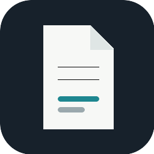

<h1>
  
  draft.nvim
</h1>

*LaTeX in flow.*

Draft pairs Neovim with a live LaTeX preview on macOS. Prose, math, TikZ and PGFPlots render beside the source; `Ctrl-G` moves between them.

Install with your Neovim plugin manager:

```lua
{ "llui2/draft.nvim" }
```

Open a `.tex` file and run `:Dp` for a live preview or `:Db` to build the project manuscript.

```vim
:Dp
:Db
```

Local `.tex` links follow the document in Neovim and Draft. Use `Ctrl-O` and `Ctrl-I` to move through document history; HTTPS links open in your browser.

Previews require macOS and Swift. PDF builds require `latexmk`; figure previews also require `pdftocairo`. See [`:help draft`](doc/draft.txt).
